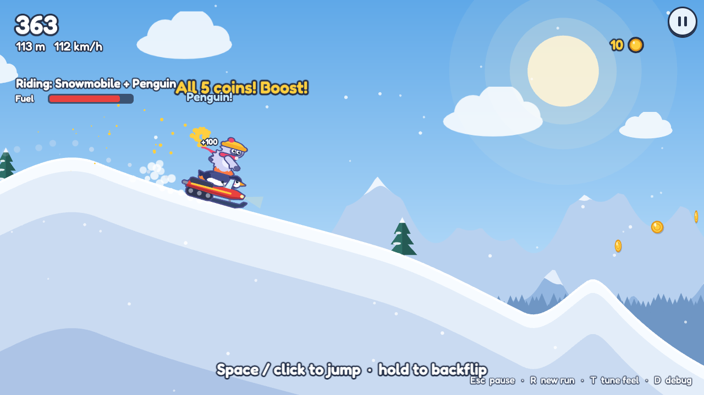
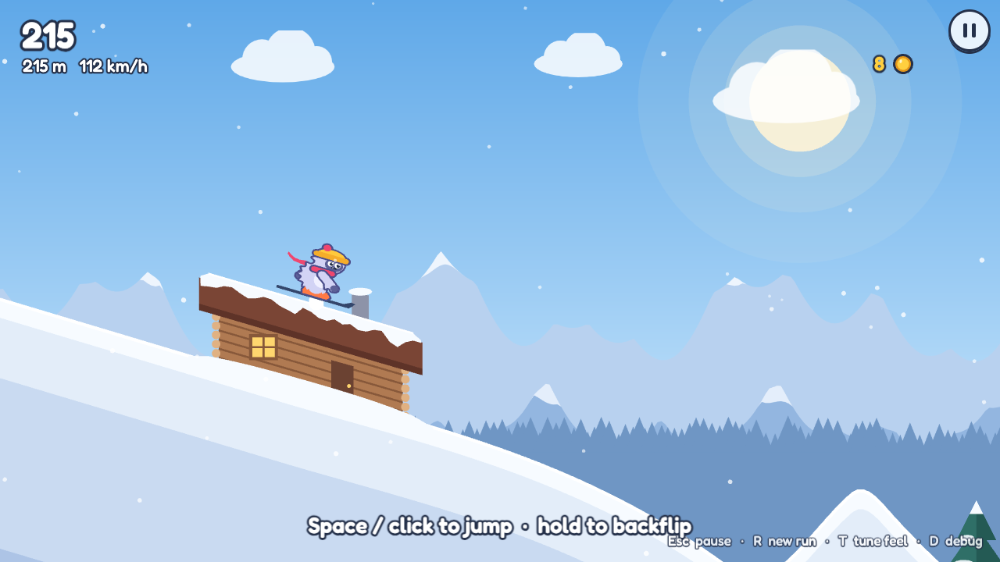
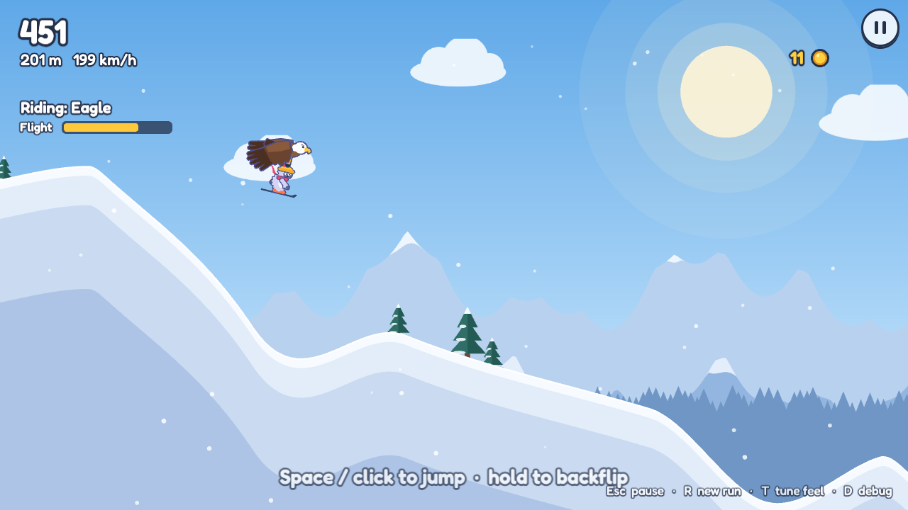
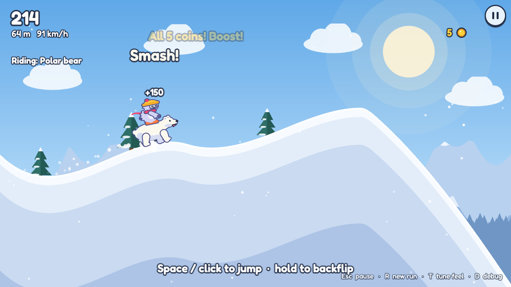
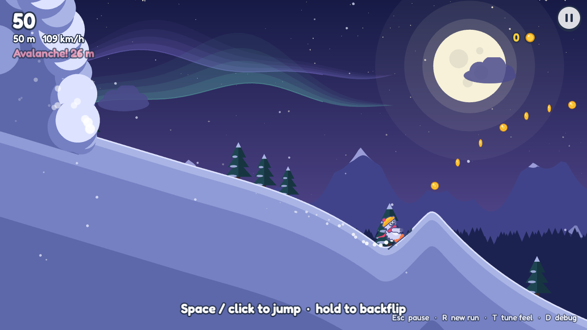

# Yeti, Set, Go!

An endless downhill skiing game for the browser, inspired by *Ski Safari*.
You play a yeti on skis, outrunning an avalanche.
Portfolio / learning project. Not affiliated with the original.

**Play it: <https://vibe-game.alfariza-ahnaf10.workers.dev>** (desktop or phone, landscape)



| | |
|---|---|
|  |  |
| Ride over cabin roofs (hit the wall and you wipe out) | An eagle carries you through the air |
|  |  |
| A polar bear smashes straight through rocks | Twilight Pines, with the avalanche close behind |

**Status: Phases 1–3 built and deployed (real-phone test pending).** Endless
procedural slope, jump, hold-to-backflip, landing judgement, crash and
recover, an avalanche chasing you, rocks, cabins with rideable roofs, ice
patches, coin clusters, mounts (penguin, eagle, snowmobile, polar bear), score
with a trick multiplier, goals and levels, a coin shop, five biomes (Sunny
Slopes, Twilight Pines, Blossom Ridge, Glacier Gorge and Ember Peak), each
with its own mix of terrain, synthesised sound and music, and title / pause /
game-over screens. See [`docs/research.md`](docs/research.md) for the plan and
[`docs/roadmap.md`](docs/roadmap.md) for progress and known rough edges.

## Run it

```bash
bun install
bun run dev        # http://localhost:5173 — also reachable from your phone on the same Wi-Fi
```

`/` is the landing page; the game itself lives at `/play/`.

Handy URL parameters (on `/play/`):

| Param | Effect |
|---|---|
| `?seed=123` | Same mountain every run (great for comparing tuning changes) |
| `?debug` | Show the debug overlay |
| `?tune` | Open the tuning panel on load |
| `?mount=penguin` | Start every run riding a mount (`penguin`, `eagle`, `snowmobile`, `bear`) |
| `?biome=twilight` | Force a biome (`alpine`, `twilight`, `blossom`, `glacier`, `ember`), even a locked one |
| `?coins=5000` | Top the wallet up to at least this many coins (for testing the shop) |
| `?profile=reset` | Wipe saved progress: coins, level, goals, upgrades |

## Controls

| Action | Desktop | Touch |
|---|---|---|
| Jump | Space / ↑ / W / click | Tap |
| Backflip | Hold while in the air | Hold |
| Pause | Esc / P | ⏸ button |
| New run | R | Pause → Restart |
| Mute all sound | M | Sound button in menus |
| Music on/off | — | Music button in menus |
| Tuning panel | T | — |
| Debug overlay | D | — |

Land with your skis roughly parallel to the snow. Clean landings after flips
give you a speed boost; landing badly is a wipeout.

Stay ahead of the avalanche: it speeds up the longer you ski, and a wipeout
lets it catch up. Jump rocks, ride over cabin roofs (hit the wall and you
wipe out), and use ice patches to pick up speed. Grab every coin in a cluster
for a speed boost; coins are saved across runs for the shop.

The mountain is built from shaped pieces: rollers, kickers, cliff drops,
bowls, big booters, steep **chutes** that plunge at 45° and more, **steps**
(a staircase of ledges), **whoops** (quick bumps to skip across) and
**gaps** (a kicker over a trench). Each biome favours its own mix: Twilight
Pines winds through bowls and bumps, Blossom Ridge is all bounce, Glacier
Gorge is chutes, gaps and long ice, and Ember Peak is ledges, cliffs and rocks.

Ski into animals to ride them. A **penguin** glides and flips faster, an
**eagle** carries you through the air for a few seconds (hold to climb), a
**snowmobile** roars along on a tank of fuel and can carry an animal too, and
a **polar bear** smashes straight through rocks and cabins. Anything you ride
is a shield: a hit knocks it off instead of wiping you out.

Score is 1 point per metre plus trick points. A clean flip
scores 100 (2 flips 300, 3 flips 600) and raises the multiplier by the
number of flips, up to ×10. A sloppy landing or a crash resets it to ×1.

You always have three **goals** (Goals on the title screen). Finish all three
to reach the next level. Levels 1–10 each have their own three goals, teaching
one new thing at a time; past level 10 they're drawn at random. Each level
multiplies your whole score by another ×0.25, and some unlock perks: level 2
starts every run on a penguin, level 3 unlocks the Twilight Pines biome,
level 4 Blossom Ridge, level 5 brings mounts more often, level 6 unlocks
Glacier Gorge, level 7 shortens wipeouts, and level 8 unlocks Ember Peak. Spend coins in the **Shop** on upgrades: head start, coin magnet,
cluster boost, avalanche delay, eagle wings, bigger tank, sturdy landings.

## Tuning the feel

Press **T** for a live panel of every feel constant (gravity, flip speed,
landing tolerance…). Changes apply instantly and persist in `localStorage`.
When something feels right, hit **Copy values** and paste them into
`src/tuning.ts`.

## Project layout

```
index.html      Landing page (src/landing.ts, src/landing.css); the yeti on it is ported from skierView.ts
play/index.html The game
src/
  sim/          Pure TypeScript game logic. No Phaser, fully unit-tested.
    terrain.ts    Endless mountain from shaped templates (mixed per biome), joined with Hermite curves
    spawner.ts    Rocks, cabins, ice and coin clusters per terrain feature, placed fairly
    skier.ts      Custom skier physics: ground / air / crash, landing judgement, hits
    mounts.ts     The mount stack, shields, eagle flight, fuel, and per-mount feel
    run.ts        One run: fixed 120 Hz step, avalanche, stats
    score.ts      Trick points and the multiplier
    meta.ts       Goals, levels, perks and shop upgrades (pure rules)
    rng.ts        Seeded PRNG
  render/       Phaser views of the sim (terrain chunks, yeti, mounts, obstacles, avalanche, sky, particles)
  ui/           HUD, DOM menus (title / pause / game over) and the tuning panel
  audio.ts      Every sound and the music loop, synthesised with WebAudio (no audio files)
  profile.ts    Saved progress (coins, level, goals, upgrades) in localStorage
  biomes.ts     Biome palettes, backdrops, terrain mixes and spawn tables
  scenes/       PlayScene wires input → sim → views, three cameras
  tuning.ts     Every feel number in one place
tests/          Vitest unit tests for the sim
scripts/
  probe.ts      Headless bots that play the sim and report air time, landings, speed, survival, mounts, coins (BIOME)
  smoke.mjs     Headless Chromium smoke test (fails on console errors)
  tour.mjs      Scripted play-through on a faked clock → screenshots/ (SEED, OBSTACLE_SEED, BIOME)
docs/
  research.md   The plan: references, mechanics, tech choices, phases
  roadmap.md    What's built versus planned, and what's next
  screenshots/  README images, picked from a tour run
```

Why custom physics instead of Matter.js / Box2D, and why templates instead of
noise for the terrain: see [`docs/research.md`](docs/research.md).

## Checks

```bash
bun run test       # unit tests
bun run typecheck
bun run probe      # headless feel stats
bun run build && bun run smoke   # browser smoke test
bun run build && bun run tour    # screenshots of key moments → screenshots/
```

`smoke` and `tour` serve the build on ports 4173 / 4175; set `PORT=…` to use
another one. To refresh the README images, run the tour (and
`BIOME=twilight bun run tour`) and copy the shots you want into
`docs/screenshots/`.

## Deploy

Hosted on Cloudflare Workers as a static site: [`wrangler.jsonc`](wrangler.jsonc)
serves the Vite build from `dist/`, and every pull request gets its own
preview URL. To deploy by hand:

```bash
bun run build && bunx wrangler deploy
```
